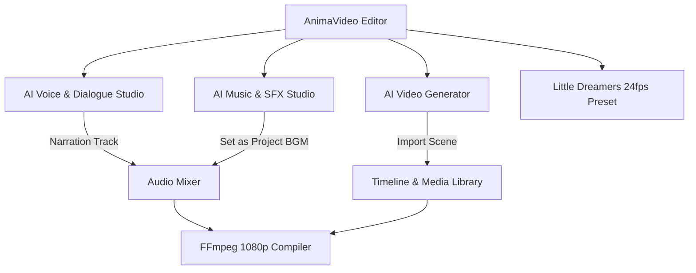

# AnimaVideo — AI Video Production Studio Guide

## Overview

**AnimaVideo AI Studio** upgrades the AnimaTube video editor into an end-to-end AI-powered animation and video production studio. Built directly on top of the PySide6 desktop framework and FFmpeg rendering pipeline, it enables creators to generate AI video scenes, character dialogue narration, and royalty-free music and sound effects—with full timeline and media library integration.

---

## Key Capabilities

1. **AI Video Generator (`VideoStudioDialog`)**:
   - **Text-to-Video (T2V)**: Generates animated video scenes from natural language prompts.
   - **Image-to-Video (I2V)**: Animates character reference anchor images with preserved visual identities.
   - **Camera Control**: Camera motion presets including *Slow Pan Left/Right*, *Tilt Up/Down*, *Slow Zoom In/Out*, and *Orbit 3D*.
   - **Timeline Integration**: Imports generated clips directly as new video scenes or background layers.

2. **AI Voice & Dialogue Studio (`AudioStudioDialog` - Character Dialogue Tab)**:
   - **Multi-Character Dialogue**: Scripts turn-by-turn dialogue lines across multiple animated characters.
   - **Voice Profiles**: Preconfigured pitch, speech rate, and conversational delivery styles.
   - **Zero Robotic Tone**: Built-in pauses, SSML phrasing, and pronunciation dictionary.

3. **AI Music & Sound Effects Studio (`MusicStudioDialog`)**:
   - **Background Music (BGM)**: High-quality instrumental loops and underscore tracks.
   - **Original Theme Songs**: Catchy vocal and instrumental songs for preschool storytelling.
   - **Sound Effects (SFX)**: Cartoon whooshes, magical star sparkles, giggles, and footsteps.
   - **Monetization Guarantee**: 100% Royalty-Free and cleared for YouTube monetization and Content ID safety.
   - **1-Click Timeline BGM**: Automatically loops, fades, and mixes music with narration at a 15% ducking level.

4. **Little Dreamers 24fps Production Preset**:
   - Preconfigured **1920×1080 16:9 @ 24fps** preschool storytelling template.
   - 6 permanent Pixar-quality 3D characters: **Aarav**, **Mia**, **Ellie**, **Gigi**, **Bobo**, and **Twinkle**.
   - Bilingual support for **English** and **Telugu** educational episodes.

---

## Zero-Cost CI & Mock Provider Architecture

Google Flow or external paid APIs are **never mandatory dependencies**.

AnimaVideo includes built-in mock providers (`MockVideoProvider`, `MockVoiceProvider`, `MockMusicProvider`) that:
- Generate valid, compliant **MP4** videos and **WAV** audio files locally on CPU.
- Accurately simulate queuing, rendering progress, and job cancellation.
- Run automatically in headless/CI test environments with zero external API calls and zero network latency.

---

## Little Dreamers Character Reference Sheet & Anchors

All characters have permanent visual anchor sheets located in `little-dreamers/flow_ready/`:

| Character | Species / Persona | Voice Profile ID | Anchor Image |
| :--- | :--- | :--- | :--- |
| **Aarav** | 2.5yo toddler boy, blue star shirt | `aarav_boy` | `aarav_flow_anchor.png` |
| **Mia** | 2.5yo toddler girl, pink flower dress | `mia_girl` | `mia_flow_anchor.png` |
| **Ellie** | Baby purple elephant with turquoise clip | `ellie_gentle` | `ellie_flow_anchor.png` |
| **Gigi** | Cheerful baby giraffe with leaf scarf | `gigi_peppy` | `gigi_flow_anchor.png` |
| **Bobo** | Chubby golden puppy with red bandana | `bobo_puppy` | `bobo_flow_anchor.png` |
| **Twinkle** | Glowing golden bedtime star baby | `twinkle_star` | `twinkle_flow_anchor.png` |

---

## Security & API Key Management

API keys for external providers (e.g. ElevenLabs, Suno, Luma, Runway) are managed securely by `AICredentialManager`:

1. **Environment Variables**:
   - `ANIMATUBE_AI_API_KEY_<PROVIDER_ID>`
2. **Local Credential Store**:
   - `~/.animatube/ai_credentials.json` (chmod 600)
3. **No Frontend Leaks**:
   - Credentials are masked (`sk-****1234`) and never exposed in UI labels or client logs.

---

## Quick Start: Launching AI Studios

From the AnimaTube Editor desktop toolbar:

- **AI Video**: Click **`AI Video`** to launch the video generator. Select a character preset (e.g., *Aarav* or *Twinkle*), choose camera motion, click **`Generate Scene`**, and click **`Import to Timeline`**.
- **AI Voice**: Click **`Audio Studio`** and switch to the **`Character Dialogue`** tab. Add dialogue lines for Aarav and Mia, select emotions, and click **`Generate Dialogue Audio`**.
- **AI Music**: Click **`AI Music`** to compose background music or sound effects. Select **`Preschool Orchestral`**, click **`Compose Music`**, and click **`🎵 Set as Project BGM`**.
- **Little Dreamers Preset**: Click **`Little Dreamers`** to instantly instantiate a full 4-scene 1080p 24fps episode project pre-loaded with character anchors.
